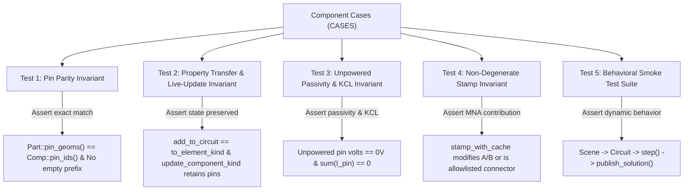

# Component Implementation Audit and Verification Plan

## 1. Executive Summary & Background

During recent development on the [`Transformer`](file:///c:/Users/veli/Projects/circuitsimulator/crates/cs-engine/src/components/transformer.rs) component (commits `246d95f0`, `69b9c42f`, `320d1cfe`), a systemic issue was uncovered:
- The component was completely implemented on the schematic side ([`Part::Transformer`](file:///c:/Users/veli/Projects/circuitsimulator/crates/cs-engine/src/components/mod.rs#L675-L785)), had property definitions, serialized to/from `.sim1`/`.circ1` XML formats, and rendered cleanly on the canvas.
- Consequently, all existing test suites in [`crates/cs-engine/src/components/harness.rs`](file:///c:/Users/veli/Projects/circuitsimulator/crates/cs-engine/src/components/harness.rs) passed 100%.
- However, in the simulation solver pipeline, the companion model was missing in [`crates/cs-engine/src/elements/stamp.rs`](file:///c:/Users/veli/Projects/circuitsimulator/crates/cs-engine/src/elements/stamp.rs), reactive updates were absent from [`crates/cs-engine/src/simulation/reactive.rs`](file:///c:/Users/veli/Projects/circuitsimulator/crates/cs-engine/src/simulation/reactive.rs), [`Comp::current_out_of_pin`](file:///c:/Users/veli/Projects/circuitsimulator/crates/cs-engine/src/elements/mod.rs#L670-L824) was unimplemented, and live property edits in [`Circuit::update_component_kind`](file:///c:/Users/veli/Projects/circuitsimulator/crates/cs-engine/src/simulation/digital_queue.rs#L17-L87) wiped component state.

A comprehensive audit of all components across `crates/cs-engine/src/components/`, `crates/cs-engine/src/elements/`, `crates/cs-engine/src/digital/`, and `crates/cs-engine/src/simulation/` revealed that this gap is not unique to `Transformer`. Multiple components exhibit similar disconnects across schematic pin definitions, simulation netlists, matrix stamping, and dynamic updates.

This document catalogs every affected component, explains why existing tests did not catch them, and defines an automated verification framework and phased remediation roadmap.

---

## 2. Audit Findings

### Category A: Pin ID & Component ID Mismatches (Wires Never Connect)

Phase 2 closed the empty-prefix bugs and the suffix mismatches named in the table below. Still open, and listed again under Phase 2: solver-only aliases, parts that are never inserted, Mux/Demux address pins past bit 2, Ws2812 `vcc`/`vdd`, QemuDevice's empty default package, and seven-segment paint still reading `a0`. The paragraphs below are the original findings.

When [`Scene::to_circuit`](file:///c:/Users/veli/Projects/circuitsimulator/crates/cs-engine/src/canvas/scene/sim1.rs#L181-L201) constructs a simulation circuit from schematic wires, wire endpoints reference pin IDs generated by [`Part::pin_geoms`](file:///c:/Users/veli/Projects/circuitsimulator/crates/cs-engine/src/components/mod.rs#L789-L905) (`"{comp_id}-{pin_id}"`).
Meanwhile, [`Circuit::build_nets`](file:///c:/Users/veli/Projects/circuitsimulator/crates/cs-engine/src/simulation/matrix_solver.rs#L479-L506) and [`Comp::stamp`](file:///c:/Users/veli/Projects/circuitsimulator/crates/cs-engine/src/elements/stamp.rs#L1172-L1645) resolve nodes via [`Comp::pin_ids`](file:///c:/Users/veli/Projects/circuitsimulator/crates/cs-engine/src/elements/pins.rs#L218-L749) and [`IoPin::id`](file:///c:/Users/veli/Projects/circuitsimulator/crates/cs-engine/src/digital/iopin.rs#L48-L62).

When these IDs do not match, the wire attaches to a pin ID that the solver never queries; the simulation node remains `0` (floating/grounded) and no current flows.

#### 1. Empty Component ID Prefix on Display Controllers & Live Updates
- **Display Controllers** ([`Pcd8544`](file:///c:/Users/veli/Projects/circuitsimulator/crates/cs-engine/src/components/pcd8544.rs#L84-L86), [`Sh1107`](file:///c:/Users/veli/Projects/circuitsimulator/crates/cs-engine/src/components/sh1107.rs#L63-L65), [`Ks0108`](file:///c:/Users/veli/Projects/circuitsimulator/crates/cs-engine/src/components/ks0108.rs#L75-L77), [`Aip31068`](file:///c:/Users/veli/Projects/circuitsimulator/crates/cs-engine/src/components/aip31068.rs#L63-L65)):
  - [`Part::add_to_circuit`](file:///c:/Users/veli/Projects/circuitsimulator/crates/cs-engine/src/components/mod.rs#L1677-L1725) calls `p.to_element_kind()`, which invokes `*State::new("", ...)`.
  - `add_to_circuit` then only mutates `st.id = id.to_string()`, but does **not** update the component prefix on the embedded [`IoPin`](file:///c:/Users/veli/Projects/circuitsimulator/crates/cs-engine/src/digital/iopin.rs#L48) structures.
  - The pins retain IDs like `"-PinRst"`, `"-PinSck"` instead of `"{id}-PinRst"`, preventing any schematic wires from connecting.
- **Live Property Updates** ([`Canvas::refresh_sim_component`](file:///c:/Users/veli/Projects/circuitsimulator/crates/cs-engine/src/canvas/sim_sync.rs#L262-L283) $\rightarrow$ [`Circuit::update_component_kind`](file:///c:/Users/veli/Projects/circuitsimulator/crates/cs-engine/src/simulation/digital_queue.rs#L17-L87)):
  - Calling `update_component_kind` with `item.to_element_kind()` replaces `c.kind` with a freshly constructed digital state where `id = ""`. This erases the prefix for all digital components upon property edits.

#### 2. Digital IC Schematic vs Simulation Pin Name Suffixes
| Component | Schematic Pin Suffixes ([`components/*.rs`](file:///c:/Users/veli/Projects/circuitsimulator/crates/cs-engine/src/components/)) | Simulation Pin Suffixes ([`digital/*.rs`](file:///c:/Users/veli/Projects/circuitsimulator/crates/cs-engine/src/digital/), [`elements/pins.rs`](file:///c:/Users/veli/Projects/circuitsimulator/crates/cs-engine/src/elements/pins.rs)) | Impact |
| :--- | :--- | :--- | :--- |
| [`FlipFlop`](file:///c:/Users/veli/Projects/circuitsimulator/crates/cs-engine/src/components/flip_flop.rs#L333-L624) | `-in0`..`-in4`, `-out0`, `-out1` | Same `inN` / `outN` suffixes ([`FlipFlopState::new`](file:///c:/Users/veli/Projects/circuitsimulator/crates/cs-engine/src/digital/flipflop.rs#L72-L118)) | Default D/JK/T/RS sets match. `UseRS=false` still leaves set/reset on the solver. Live property edits clear the component prefix. |
| Logic Gates ([`AndGate`](file:///c:/Users/veli/Projects/circuitsimulator/crates/cs-engine/src/components/and_gate.rs#L266), [`OrGate`](file:///c:/Users/veli/Projects/circuitsimulator/crates/cs-engine/src/components/or_gate.rs#L229), etc.) | `-Pin_outEnable` when tristate is on | And/Or/Xor: pin omitted (`add_to_circuit` drops `tristate`). Not/Buffer: `-Pin_outEnable` always present | Output enable is missing on And/Or/Xor. Not/Buffer expose it even when tristate is off. Live edits clear the prefix on every gate. |
| [`Counter`](file:///c:/Users/veli/Projects/circuitsimulator/crates/cs-engine/src/components/counter.rs#L152-L205) | `-in0`, `-in1`, `-out0` | `-clk`, `-rst`, `-en`, `-out`, `-q0`..`-q{b-1}` | Counter inputs & outputs never connect |
| [`BinCounter`](file:///c:/Users/veli/Projects/circuitsimulator/crates/cs-engine/src/components/bin_counter.rs#L124-L226) | `-Pin_clk`, `-Pin_rst`, `-out0`..`-out{b-1}` | 7490 pins: `-clka`, `-clkb`, `-r0_1`, `-r0_2`, `-r9_1`, `-r9_2`, `-q0`..`-q3` | Complete disconnect |
| [`FullAdder`](file:///c:/Users/veli/Projects/circuitsimulator/crates/cs-engine/src/components/full_adder.rs#L133-L199) / [`HalfAdder`](file:///c:/Users/veli/Projects/circuitsimulator/crates/cs-engine/src/components/half_adder.rs#L134-L182) | `-in1`..`-in{2*b}`, `-out1`..`-out{b}` | `-a0`.., `-b0`.., `-s0`.., `-cin`, `-cout` | Disconnected |
| [`MagnitudeComp`](file:///c:/Users/veli/Projects/circuitsimulator/crates/cs-engine/src/components/magnitude_comp.rs#L141-L240) | `-in0`..`-in{2+2*b}`, `-out0`..`-out2` | `-a0`.., `-b0`.., `-in_gt`, `-in_eq`, `-in_lt`, `-out_gt`, `-out_eq`, `-out_lt` | Disconnected |
| [`ShiftReg`](file:///c:/Users/veli/Projects/circuitsimulator/crates/cs-engine/src/components/shift_reg.rs#L135-L202) | `-in0`..`-in3`, `-out0`.. | `-ds`, `-sh_cp`, `-st_cp`, `-mr`, `-oe`, `-q7s`, `-q0`.. | Disconnected |
| [`Function`](file:///c:/Users/veli/Projects/circuitsimulator/crates/cs-engine/src/components/function.rs#L168-L201) | `-in0`..`-in{n-1}`, `-out0` | `-A`..`-H`, `-out` | Disconnected |
| [`BcdTo7Segment`](file:///c:/Users/veli/Projects/circuitsimulator/crates/cs-engine/src/components/bcd_to_7segment.rs#L127-L187) | `-out0`..`-out6`, `-in4` | `-a`..`-g`, `-lt`, `-rbi`, `-bi_rbo` | Disconnected |
| [`BcdToDec`](file:///c:/Users/veli/Projects/circuitsimulator/crates/cs-engine/src/components/bcd_to_dec.rs#L184-L194) / [`DecToBcd`](file:///c:/Users/veli/Projects/circuitsimulator/crates/cs-engine/src/components/dec_to_bcd.rs#L165-L213) | `-in4` (OE) / `-in15` (OE) | Simulation missing OE or expects `-gs`, `-eo`, `-ei` | OE / control pins disconnected |
| [`I2CToParallel`](file:///c:/Users/veli/Projects/circuitsimulator/crates/cs-engine/src/components/i2c_to_parallel.rs#L128-L212) | `-in0`..`-in5`, `-out0`..`-out7` | `-scl`, `-sda`, `-int`, `-p0`..`-p7` | Disconnected |
| [`Adc`](file:///c:/Users/veli/Projects/circuitsimulator/crates/cs-engine/src/components/adc.rs#L202-L233) | `-in0`, `-out0`..`-out{b-1}` | `-vin`, `-d0`..`-d{b-1}`, `-soc`, `-eoc`, `-oe` | Disconnected |
| [`Dac`](file:///c:/Users/veli/Projects/circuitsimulator/crates/cs-engine/src/components/dac.rs#L160-L191) | `-in0`..`-in{b-1}`, `-out0` | Pins: `-vout`, `-vref`, `-d0`.. (and stamp queries `-outnod`) | Disconnected and stamp node lookup error |
| [`Memory`](file:///c:/Users/veli/Projects/circuitsimulator/crates/cs-engine/src/components/memory.rs#L217-L292) / [`DynamicMemory`](file:///c:/Users/veli/Projects/circuitsimulator/crates/cs-engine/src/components/dynamic_memory.rs#L152-L236) / [`I2CRam`](file:///c:/Users/veli/Projects/circuitsimulator/crates/cs-engine/src/components/i2c_ram.rs#L169-L229) | Generic `-in*`, `-out*`, `-Pin_We`, etc. | `-a*`, `-d*`, `-cs`, `-oe`, `-we`, `-ras`, `-cas`, `-scl`, `-sda` | Memory busses completely disconnected |
| [`Mux`](file:///c:/Users/veli/Projects/circuitsimulator/crates/cs-engine/src/components/mux.rs#L130) | Hardcodes 3 address pins (`-addr0`..`-addr2`) and clamps inputs to 16 | `addr_bits` can be 1..5 (up to 32 inputs) | Bits > 3 cannot address high inputs |
| [`SevenSegment`](file:///c:/Users/veli/Projects/circuitsimulator/crates/cs-engine/src/components/seven_segment.rs#L278-L305) | Multi-digit creates `-pin_commonb`..`-pin_commonh` | [`Comp::pin_ids`](file:///c:/Users/veli/Projects/circuitsimulator/crates/cs-engine/src/elements/pins.rs#L519-L541) only defines `-pin_commona` | Additional digits cannot be multiplexed; [`SevenSegment::paint`](file:///c:/Users/veli/Projects/circuitsimulator/crates/cs-engine/src/components/seven_segment.rs#L371-L396) queries `"{id}-a0"` instead of `"{id}-pin_a"`, so segments never illuminate |

---

### Category B: Stubbed, Unstepped, or Non-Dynamic Simulation Models

Phase 3 covers sections 1 and 2 below. Phase 4 covers the relay, controlled source, stepper, lamp, and LED-array items in section 4. Phase 5 covers `Max72xx` and `Ws2812` in section 3, the sensor paragraph in section 4, and the display controllers named in the Phase 5 section (`Pcd8544`, `Sh1107`, `Ks0108`, `Aip31068`). The other empty stamps in section 3, and the power semiconductors in section 4, are still open. The paragraphs are the original findings.

#### 1. Digital IC Outputs Never Trigger Matrix Solutions
- In [`Circuit::digital_volt_changed`](file:///c:/Users/veli/Projects/circuitsimulator/crates/cs-engine/src/simulation/digital_queue.rs#L486-L733), handlers for `Mux`, `Demux`, `BcdToDec`, `DecToBcd`, `BcdTo7S`, `Adc`, `Dac`, `Counter`, `BinCounter`, `FullAdder`, `HalfAdder`, `MagnitudeComp`, `ShiftReg`, `Function`, `Memory`, `DynamicMemory`, `I2CRam`, and `Lm555` update their internal `IoPin` logic levels, but conclude with:
  ```rust
  continue; // Does not set stamp_changed = true!
  ```
- Because `stamp_changed` remains `false`, [`Circuit::solve_circuit`](file:///c:/Users/veli/Projects/circuitsimulator/crates/cs-engine/src/simulation/matrix_solver.rs#L51-L53) does not re-stamp or re-solve the analog/digital MNA matrix. Output pins never drive connected analog circuitry.

#### 2. Clock Sources
- [`Kind::Clock`](file:///c:/Users/veli/Projects/circuitsimulator/crates/cs-engine/src/elements/mod.rs#L194-L198): Stamps an independent voltage source based on `self.state`, but `Clock` is not registered in [`Circuit::has_time_sources`](file:///c:/Users/veli/Projects/circuitsimulator/crates/cs-engine/src/simulation/reactive.rs#L23-L32), [`Circuit::update_sources`](file:///c:/Users/veli/Projects/circuitsimulator/crates/cs-engine/src/simulation/reactive.rs#L34-L60), or [`Circuit::run_event`](file:///c:/Users/veli/Projects/circuitsimulator/crates/cs-engine/src/simulation/digital_queue.rs#L172-L386). Its output stays at `0 V` indefinitely.

#### 3. Empty `{}` Stamp Implementations
In [`crates/cs-engine/src/elements/stamp.rs`](file:///c:/Users/veli/Projects/circuitsimulator/crates/cs-engine/src/elements/stamp.rs), the following components have empty stub arms (`{}`):
- `LedMatrix` (L1109)
- `Max72xx` (L1110)
- `Ws2812` (L1111)
- `SevenSegmentBCD` (L1115)
- `SdCard` (L1443)
- `TftDisplay` & `Pcf8833Display` (L1453)
- `SerialPort` & `SerialTerm` (L1638-L1639)
- `FreqMeter` (L328, L649)

#### 4. Electromechanical & Controlled Models
- **[`Relay`](file:///c:/Users/veli/Projects/circuitsimulator/crates/cs-engine/src/elements/stamp.rs#L1116-L1135)**:
  - Coil resistance is hardcoded to `100.0 Ω`.
  - The switch state `active` is never updated from coil current; `i_on` and `i_off` properties are ignored.
  - Multi-pole (`poles`), `double_throw`, and `norm_close` parameters are unhandled in the solver.
- **[`Csource`](file:///c:/Users/veli/Projects/circuitsimulator/crates/cs-engine/src/elements/stamp.rs#L1001-L1019)**:
  - Stamps static `volt`/`current` between `s1Pin` and `s2Pin`. It never reads controlling pins `cpPin`/`cmPin` or multiplies by `gain`.
- **[`Stepper`](file:///c:/Users/veli/Projects/circuitsimulator/crates/cs-engine/src/simulation/periph_sync.rs#L245-L304)**:
  - Coils are stamped as simple resistors, but [`Circuit::update_motors_dt`](file:///c:/Users/veli/Projects/circuitsimulator/crates/cs-engine/src/simulation/periph_sync.rs#L245-L304) only steps `DcMotor` and `Servo`. `Stepper::angle` is never updated or published.
- **[`Lamp`](file:///c:/Users/veli/Projects/circuitsimulator/crates/cs-engine/src/elements/mod.rs#L484-L489)**:
  - Modeled as a static resistor (`r_cold`); thermal temperature and dynamic filament resistance are not simulated.
- **LED Arrays ([`RgbLed`](file:///c:/Users/veli/Projects/circuitsimulator/crates/cs-engine/src/elements/stamp.rs#L1589-L1606), [`LedBar`](file:///c:/Users/veli/Projects/circuitsimulator/crates/cs-engine/src/elements/stamp.rs#L1607-L1619), [`SevenSegment`](file:///c:/Users/veli/Projects/circuitsimulator/crates/cs-engine/src/elements/stamp.rs#L1620-L1634))**:
  - Instead of standard diode companion models, these stamp an unconditional `1.8 V / 100 Ω` active Norton source (`18 mA`), injecting power into unpowered circuits.
- **Sensors ([`Sr04`](file:///c:/Users/veli/Projects/circuitsimulator/crates/cs-engine/src/elements/stamp.rs#L1291-L1309), [`Dht22`](file:///c:/Users/veli/Projects/circuitsimulator/crates/cs-engine/src/elements/stamp.rs#L1310-L1324), [`Ds18b20`](file:///c:/Users/veli/Projects/circuitsimulator/crates/cs-engine/src/elements/stamp.rs#L1325-L1337), [`Ds1621`](file:///c:/Users/veli/Projects/circuitsimulator/crates/cs-engine/src/elements/stamp.rs#L1338-L1354), [`Ds1307`](file:///c:/Users/veli/Projects/circuitsimulator/crates/cs-engine/src/elements/stamp.rs#L1355-L1369), [`Esp01`](file:///c:/Users/veli/Projects/circuitsimulator/crates/cs-engine/src/elements/stamp.rs#L1444-L1452))**:
  - Stamp static boolean states (`echo_high`, `out_state`, `dq_low`, `sda_low`, `sqw_state`) without active protocol state machines.
- **Power Semiconductors ([`Scr`](file:///c:/Users/veli/Projects/circuitsimulator/crates/cs-engine/src/elements/mod.rs#L563-L598), [`Diac`](file:///c:/Users/veli/Projects/circuitsimulator/crates/cs-engine/src/elements/mod.rs#L599-L630), [`Triac`](file:///c:/Users/veli/Projects/circuitsimulator/crates/cs-engine/src/elements/mod.rs#L631-L665))**:
  - Ignore their configured properties (`i_trig`, `r_gate`, `res_off`, `res_on`, `hold_curr`) in favor of hardcoded constants, and fall through [`Comp::stamp_with_cache`](file:///c:/Users/veli/Projects/circuitsimulator/crates/cs-engine/src/elements/stamp.rs#L1168) to uncached stamping.

---

### Category C: Properties Dropped in [`Part::add_to_circuit`](file:///c:/Users/veli/Projects/circuitsimulator/crates/cs-engine/src/components/mod.rs#L1650-L2200)

Phase 2 routes the parts below through `to_element_kind`. Two exceptions stay: gate parts have no `open_col` field (`GateState::set_open_col` is still what the sim1 loader calls), and `Lm555::step` overwrites `out_high_v` / `out_low_v` from the supply rails after the property is copied. The list below is the original finding.

When `Scene` builds the simulation circuit, `Part::add_to_circuit` extracts properties from `Part` into `Kind`. Several components fail to transfer their properties:
- [`ResistorDip`](file:///c:/Users/veli/Projects/circuitsimulator/crates/cs-engine/src/components/mod.rs#L1740): Hardcodes `bussed: false`, ignoring `p.bussed`.
- [`Ldr`](file:///c:/Users/veli/Projects/circuitsimulator/crates/cs-engine/src/components/mod.rs#L1748): Passes `resistance: p.r_light` instead of calculating resistance based on `lux`, `r_dark`, `r_light`, and `gamma`.
- Logic Gates ([`AndGate`](file:///c:/Users/veli/Projects/circuitsimulator/crates/cs-engine/src/components/mod.rs#L1886-L1893), etc.): Drop `invert_inputs`, `init_high`, `tristate`, and `open_col`.
- Flip-Flops & Latches ([`FlipFlop`](file:///c:/Users/veli/Projects/circuitsimulator/crates/cs-engine/src/components/mod.rs#L1926-L1937), [`Latch`](file:///c:/Users/veli/Projects/circuitsimulator/crates/cs-engine/src/components/mod.rs#L1938-L1944)): Drop `use_rs`, `trigger`, `reset_inverted`, `clock_inverted`, `use_reset`, `tristate`, and `invert_inputs`.
- [`Lm555`](file:///c:/Users/veli/Projects/circuitsimulator/crates/cs-engine/src/components/mod.rs#L2176-L2182): Drops `out_high_v` and `out_low_v`.
- [`Jfet`](file:///c:/Users/veli/Projects/circuitsimulator/crates/cs-engine/src/components/mod.rs#L1305-L1308): Drops `p_channel`.

---

## 3. Root Cause: Why Existing Tests Did Not Catch These

The existing test harness in [`crates/cs-engine/src/components/harness.rs`](file:///c:/Users/veli/Projects/circuitsimulator/crates/cs-engine/src/components/harness.rs) executes tests against every entry in [`CASES`](file:///c:/Users/veli/Projects/circuitsimulator/crates/cs-engine/src/components/harness.rs#L57-L1520), but only tests:
1. Schematic geometry integrity (`pin_geoms` non-empty, `body` bounds valid).
2. Property table serialization round-trips (`set_prop` / `get_prop`).
3. XML `.sim1` and `.circ1` persistence.
4. That `Part::to_element_kind()` returns the matching enum variant of `Kind` ([`live_sim_kind_without_rebuild`](file:///c:/Users/veli/Projects/circuitsimulator/crates/cs-engine/src/components/harness.rs#L1608-L1735)).

**Crucially, the test suite never:**
- Compares `Part::pin_geoms()` with `Comp::pin_ids()`.
- Verifies that `Part::add_to_circuit()` produces the same configured properties as `Part::to_element_kind()`.
- Verifies that live property updates preserve internal pin prefixes and states.
- Connects pins into a test netlist to execute `Circuit::solve()` or `Circuit::step()`.
- Verifies that digital event outputs trigger matrix re-solving.

---

## 4. Automated Verification Strategy

To catch all existing issues and prevent regressions, we define an invariant-based test architecture to be integrated into `cs-engine`:



### Invariant 1: Schematic $\leftrightarrow$ Solver Pin Parity Test
- **Location**: `crates/cs-engine/src/components/tests/pin_parity.rs`.
- **Procedure**:
  1. For every case in `CASES`, instantiate the `Part`.
  2. Test default pin configuration as well as parameterized variants (`Bits`, `Num_Inputs`, `Addr_Bits`, `Tristate`, `Poles`, `Double_Throw`, `Displays`).
  3. Call `part.add_to_circuit("U1", &mut circuit)`.
  4. Compare `part.pin_geoms().iter().map(|p| format!("U1-{}", p.id))` against `comp.pin_ids()`.
  5. **Assertions**:
     - Both sets must be identical (modulo documented internal MNA nodes like Diode `-mid`).
     - No pin ID in `comp.pin_ids()` may begin with `"-"` (verifies component ID prefixing).

### Invariant 2: Property Preservation & Live-Update Test
- **Procedure**:
  1. For each `Case`, construct `Part` and set each property in `c.extras`.
  2. Create a circuit via `add_to_circuit("U1", &mut circuit)`.
  3. Call `circuit.update_component_kind("U1", &part.to_element_kind())`.
  4. **Assertions**:
     - `comp.pin_ids()` before and after update must match identically.
     - Internal states (e.g., memory arrays, integrator histories, motor angles) must not be zeroed out.
     - Changing functional parameters (e.g., `ResistorDip::Bussed`, `Ldr::Lux`, `Gate::Invert_Inputs`) must alter the solver `Comp` properties.

### Invariant 3: Unpowered Passivity & KCL Conservation Test
- **Procedure**:
  1. For all non-source components, connect every external pin to Ground through a $1\text{ k}\Omega$ resistor.
  2. Execute `circuit.solve_circuit()`.
  3. **Assertions**:
     - All pin voltages must be $0.0\text{ V}$ (catches `RgbLed`, `LedBar`, `SevenSegment` injecting phantom $1.8\text{ V}$).
  4. Connect a series $5\text{ V}$ source through a $1\text{ k}\Omega$ resistor to one pin, solve, and check [`Comp::current_out_of_pin`](file:///c:/Users/veli/Projects/circuitsimulator/crates/cs-engine/src/elements/mod.rs#L670-L824).
  5. Sum of all currents exiting pins must equal zero ($\sum I = 0$, Kirchhoff's Current Law).

### Invariant 4: Stamp Non-Degeneracy & Reactive/Source Registration Test
- **Procedure**:
  1. Place component into a 2-node test circuit.
  2. Stamp the circuit into an MNA matrix.
  3. **Assertions**:
     - Components with empty `{}` stamps must either be explicitly documented passive connectors (`Bus`, `Header`, `Socket`, `Tunnel`) or fail this test.
     - If component is reactive (`Capacitor`, `Inductor`, `VarCapacitor`, `VarInductor`, `Transformer`), assert `circuit.has_reactive() == true`.
     - If component is time-dependent (`Clock`, `WaveGen`, `VoltReg`), assert `circuit.has_time_sources() == true` and verify state toggles over time.

### Invariant 5: Behavioral Simulation Smoke Suite
- **Location**: `crates/cs-engine/tests/simulation_smoke.rs`
- **Coverage**:
  - **Digital Logic**: Feed clock into gates/counters/flip-flops; verify that output logic transitions set `stamp_changed = true` and update connected analog nodes.
  - **Relays & Electromechanical**: Energize coil above `i_on`; verify switch closes, resistance drops to contact resistance, and de-energizing below `i_off` re-opens the switch.
  - **Controlled Sources**: Apply input voltage to `Csource`; verify output scales precisely by `gain`.
  - **Display / Peripheral Sync**: Step display controllers and verify framebuffers/readings publish to `Canvas`.

---

## 5. Remediation Roadmap


### Phase 1: Invariant Test Suite Setup

Done. `pin_parity_and_live_prefix` in [`crates/cs-engine/src/components/tests/pin_parity.rs`](file:///c:/Users/veli/Projects/circuitsimulator/crates/cs-engine/src/components/tests/pin_parity.rs) walks every harness case, including each extra property value.

For each part it:

1. Builds schematic pin ids the same way [`Item`](file:///c:/Users/veli/Projects/circuitsimulator/crates/cs-engine/src/canvas/scene/item.rs#L305-L313) does (`"{id}{suffix}"` when the suffix already starts with `-`).
2. Inserts the part with `add_to_circuit("U1", ...)` and compares that set to `Comp::pin_ids()`.
3. Treats `U1-mid` as the diode companion node, not a schematic pin.
4. Calls `update_component_kind` with `to_element_kind()` and requires the solver pin set to stay the same.

The failure list is locked in [`pin_parity_expected.txt`](file:///c:/Users/veli/Projects/circuitsimulator/crates/cs-engine/src/components/tests/pin_parity_expected.txt). The test fails when a listed mismatch disappears or a new one appears. Update that file in the same change that fixes a pin. Phase 1 locked 94 lines. Phase 2 replaced the file with the 28-line residue recorded under Phase 2.

### Phase 1 measurements

This is the snapshot Phase 2 started from. 118 harness types. 48 fail on the default part. The file also records property values whose pin set differs from that default (94 lines total).

Failures fall into five groups:

1. **Live prefix cleared.** `to_element_kind()` builds digital pins with an empty component id, and `update_component_kind` replaces the kind outright. Gates, flip-flops, latches, muxes, adders, counters, shift registers, memory, converters, ADC, function, HD44780, SSD1306, and the test unit. DAC clears only the `dN` pins; `vout` and `vref` stay prefixed because they are formatted from `Comp.id`.
2. **Bare prefix at insert.** `Pcd8544`, `Sh1107`, `Ks0108`, and `Aip31068` set `state.id` and leave `IoPin` ids as `-PinRst`. `QemuDevice` publishes the same class of `-Gnn` / `-Rst` ids.
3. **Schematic suffix ≠ solver suffix.** Counters, binary counters, shift registers, magnitude comparators, adders, BCD converters, ADC, DAC, I2C parallel, memory, dynamic memory, I2C RAM, function, and WS2812 (`vcc` vs `vdd`). Wires land on ids the solver never queries.
4. **Solver-only aliases.** The schematic names are present, so a wire can still attach, and the solver also publishes extra ids: potentiometer `PinA`/`PinB`/`PinM`, op-amp power pins (unless `PowerPins` is on), seven-segment short names, analog mux `chN`/`com`/`en`, touchpad `nodeX`/`nodeY`, SCR `lPin`/`rPin`, triac `mt1Pin`/`mt2Pin`, MAX7219 `dout`.
5. **Not inserted.** `Bus`, `Socket`, `Header`, `SerialPort`, and `SerialTerm` hit an empty arm in `add_to_circuit`. `SubPackage` does too once it has pins. `Tunnel` is inserted, then a live update replaces its pin id with an empty string.

`ResistorDip` with `Bussed=true` is the property-transfer case: the solver stays a set of independent resistors, and the live update (which uses `to_element_kind`) switches the pins to the bussed set.

Saved circuits address pins by these suffixes. Phase 2 changed the solver pin ids to the schematic suffixes. Renaming the schematic pins would leave existing wires attached to ids nothing queries.

Phase 2 cleared groups 1 and 2, the suffix mismatches in group 3 except Ws2812, and the Tunnel line in group 5.

### Phase 2: Pin ID & Prefix Unification

Done. `pin_parity_and_live_prefix` is green. The locked inventory went from 94 lines to 28. `cargo test -p cs-engine` passed after the inventory refresh.

Unbound digital constructors still build pins as `-{suffix}` because `to_element_kind()` has no placed id. [`Kind::rebind_id`](file:///c:/Users/veli/Projects/circuitsimulator/crates/cs-engine/src/elements/rebind.rs) rewrites a leading `-` into `{comp_id}-` and leaves an id that already starts with that prefix alone. [`Circuit::add_comp`](file:///c:/Users/veli/Projects/circuitsimulator/crates/cs-engine/src/simulation/builder.rs) calls it before the component is pushed. The replace arm of [`Circuit::update_component_kind`](file:///c:/Users/veli/Projects/circuitsimulator/crates/cs-engine/src/simulation/digital_queue.rs) calls it after the kind is swapped. Display state ids (`Pcd8544`, `Sh1107`, `Ks0108`, `Aip31068`, `Hd44780`, `Ssd1306`) and an empty Qemu `uid` are filled in the same walk. A live Tunnel edit that arrives with an empty `pin_id` keeps the previous pin id, then rebind runs.

Solver suffixes now match the schematic names for the parts in the original bullet:

- **Counter.** Clock `in0`, reset `in1`, output `out0`. Enable and the internal `q` pins stay off `pin_ids`. The handler forces enable high, because a pin that is not in a net reads 0 V.
- **BinCounter.** `Pin_clk`, `Pin_rst`, `out{i}`. `clk_b`, the second reset, and the set-9 pins stay internal. The handler copies the schematic reset onto the second reset input and holds set-9 low. `clk_b` is not tied to the schematic clock, so a single clock still does not binary-count both sections.
- **FullAdder / HalfAdder.** Data `in{1+i}` and `in{1+bits+i}`, sums `out{1+i}`. Carry stays `ci` / `co`. HalfAdder omits `ci`.
- **MagnitudeComp.** Cascades `in0`..`in2`, data `in{3+i}` and `in{3+bits+i}`, outputs `out0`..`out2`.
- **ShiftReg.** `in0`..`in3` and `out{i}`. The latch clock and `q7s` stay internal. The handler copies the shift clock onto the latch clock.
- **Function.** `in{i}` and `out0`. Expression letters A..H still index those inputs.
- **FlipFlop.** Default D/JK/T/RS names already matched. `pin_ids` omits set and reset on D/JK/T when `use_rs` is off. RS always publishes them, because they are the data pins.
- **Logic gates.** The original bullet said OE was `-oe`. The schematic suffix is `-Pin_outEnable`, and only while tristate is on. `buffer()` no longer installs that pin. `set_tristate(true)` creates it and `set_tristate(false)` removes it. And/Or/Xor/Not/Buffer insert through `to_element_kind`, so `invert_inputs`, `init_high`, `tristate`, and `invert_output` land. Gate parts have no `open_col` field.
- **Latch.** Pins are `clk`, `rst`, and `oe`, published only when the trigger is not `None`, `use_reset` is on, and `tristate` is on.
- **BcdTo7Segment.** Segments `out{i}`, blanking `in4`. Lamp-test and ripple-blank stay internal and are forced high (both are active-low).
- **BcdToDec.** Formatted `in4` is published with the data pins.
- **DecToBcd.** Data count is 9, or 15 when `sixteen` is on, so the last data pin no longer collides with OE. Enable is `in15`. `gs` and `eo` stay off `pin_ids`.
- **I2CToParallel.** `in0`, `in1`, `in5`, and `out{i}`, plus formatted address pins `in2`..`in4`. The device address is still the property.
- **Adc.** Outputs `out{i}` and a formatted `in0`. The analog cache lookup is `-in0`. Output-enable is forced high. `soc` and `eoc` stay off `pin_ids`.
- **Dac.** Inputs `in{i}` and a formatted `out0`. `stamp_to_gnd` targets `out0`. `vref` stays the state field.
- **Memory / DynamicMemory.** Address `in{i}`, data `out{i}`, `Pin_Cs`, `Pin_outEnable`, `Pin_We`. Dynamic memory also publishes `Pin_Ras` and `Pin_Cas`.
- **I2CRam.** `in0` and `in1`, plus formatted `in2`..`in4`.
- **SevenSegment.** `num_displays` is on the kind (clamped 1..4). `pin_ids` publishes `pin_common{letter}` for each digit. The stamp walks every common with the existing 100 Ω / 1.8 V model. Short aliases `a`..`g`, `dp`, and `com` are still published. Paint still queries `a0`.

`add_to_circuit` now uses `to_element_kind` for `ResistorDip` (`bussed`), `Ldr`, the five gate parts, `FlipFlop`, `Latch`, `Lm555`, and `SevenSegment`. `add_comp` rebinds afterward, which is idempotent. `Ldr::resistance` is `RLight * (1000 / lux) ^ 0.85`, clamped to the span of `RLight` and `RDark`, and the sim1 loader and the part stamp use that same function. At the default lux of 1 the simulated resistance is no longer `RLight`. `Jfet` carries `p_channel`: a p-channel device mirrors the terminal voltages into the n-channel equation and negates the resulting current. `Lm555` copies `out_high_v` and `out_low_v` onto the state; `step` still replaces them from the rails.

Left in [`pin_parity_expected.txt`](file:///c:/Users/veli/Projects/circuitsimulator/crates/cs-engine/src/components/tests/pin_parity_expected.txt) on purpose:

- Solver-only aliases: potentiometer `PinA`/`PinB`/`PinM`, LED `Grounded=true` `rPin`, op-amp `powerNeg`/`powerPos` (`PowerPins=true` matches), analog mux `chN`/`com`/`en`/`pinAddrN`, touchpad `nodeX`/`nodeY`, seven-segment short names, MAX7219 `dout`, SCR `lPin`/`rPin`, triac `mt1Pin`/`mt2Pin`.
- Mux and Demux `AddrBits=4`: the schematic generators hardcode `addr0`..`addr2`, so `addr3` is only on the solver.
- Ws2812: schematic `vcc`, solver `vdd`.
- Never inserted: `Bus`, `Socket`, `Header`, `SerialPort`, `SerialTerm`, `SubPackage`.
- `QemuDevice`: prefixes are present. The default package contributes no schematic pins, so `Gnn` and `Rst` stay only-solver.

Also left for a later phase: seven-segment illumination (`a0` vs `pin_a`), the counter bit clamp (solver 1..16, schematic up to 32), and the bin-counter single-clock model.

### Phase 3: Digital Queue & Event Stamping

Done. A digital output that changes its Norton pair `(V, G)` sets `stamp_changed`, and [`Circuit::solve_circuit`](file:///c:/Users/veli/Projects/circuitsimulator/crates/cs-engine/src/simulation/matrix_solver.rs) stamps again. [`Kind::Clock`](file:///c:/Users/veli/Projects/circuitsimulator/crates/cs-engine/src/elements/mod.rs) is a time source: it is registered, its level follows circuit time, and a device event fires on each edge.

`digital_volt_changed` still samples and evaluates the same parts. After `eval` / `convert` / `step` / `tick` it compares the drive that the stamp actually uses:

- IoPin outputs: mux Y and Y-not, demux outputs, BCD decoder outputs, decimal-to-BCD outputs plus `gs` and `eo`, seven-segment segments, ADC outputs and `eoc`, counter Q pins and `out0`, binary-counter outputs, adder sums and carry, magnitude outputs, shift-register outputs and the internal serial out, function `out0`, memory and dynamic-memory data pins, I2C RAM `sda`.
- DAC compares `vout` (stamped on `out0`).
- LM555 compares `out_state`, `discharge_on`, `out_high_v`, and `out_low_v`.

Unchanged drive does not request another solve, so a steady input still converges. A linear circuit may take one pass per combinational stage, capped at 32 (`DIGITAL_SETTLE_ITERS`). Past that the solve returns `NotConverged`. Circuits with a nonlinear part keep using `max_nl_steps`.

The clock level is derived from time, low for the first half period, which matches a new clock (`state == false` stamps 0 V). `freq_khz` is kilohertz, so the period is `1e9 / freq_khz` picoseconds. `has_time_sources` is true when `freq_khz > 0`. `update_sources` writes `state` from the current time. `start_mcus` arms the first edge, and the device arm of `run_event` reschedules the next one. A zero or non-finite frequency stays low and schedules nothing.

Solver tests: a function chain, a full-scale DAC, a one-bit counter terminal count, and a 1 kHz clock each drive a resistive load. `cargo test -p cs-engine` passed.

Left for later: I2C-to-parallel still only samples its pins, and a live frequency edit does not cancel an already armed edge (the edge handler recomputes the level from the new frequency when it fires). Phase 5 sets `stamp_changed` when the Aip31068 or Sh1107 SDA Norton pair moves, and when a Max72xx, Ws2812, or sensor drive changes. Pcd8544 and Ks0108 pins are inputs. Their handlers return without a re-stamp, because those Norton pairs do not move, and the framebuffer updates in the existing `step()`. Servo re-stamp was outside Phase 5.

### Phase 4: Electromechanical & Analog Companions

Done. The relay, controlled source, LED arrays, stepper, and lamp follow coil current, control gain, diode companions, shaft angle, and filament heat. `cargo test -p cs-engine` passed (813 library tests, and the integration suites).

**Relay.** The coil is a resistor. `r_coil` comes from the part property `Rcoil` (default 100 Ω) and from the sim1 attribute of the same name. `Inductance` stays on the part and is not stamped. Coil current is `(Vl − Vr) / r_coil` when both coil nodes exist. An open coil terminal is 0 A, and a relay that was pulled in with an open coil drops out. `|I|` at or above `i_on` sets `active`; `|I|` below `min(i_off, i_on)` clears it; the band between holds the previous state. A 1 nA tolerance covers a coil fed by a finite-admit voltage source, whose current lands just under `V/R` when the threshold is set to that ratio. `reset_device_stamps` leaves `active` alone, so `re_solve` keeps the hysteresis. The closed contact admit is `SWITCH_CLOSED_ADMIT` (1 mΩ). Electrical closure is `active` for a normally-open relay and the complement for a normally-closed one. SPST stamps common–throw 0 when closed. Double-throw always stamps one throw: throw 0 when closed, throw 1 otherwise. Pole 0 keeps `-c1` and `-c2`; double-throw adds `-c3`. Later poles are `-c1p{i}`, `-c2p{i}`, and `-c3p{i}`. Those extra pins exist only when `poles > 1` or double-throw is on, on both the schematic and the solver. The default one-pole SPST pin set is unchanged.

**Csource.** `control_pins == false` still stamps the fixed `volt` or `current`, and that source stays on the linear solve path. With control pins, the output is `gain` times the sample in `ctrl`. Each stamp begins by clearing node volts, so the stamp uses the sample saved after the previous solve. `update_nonlinear` reads `cpPin` and `cmPin` and asks for another stamp when the sample moves by more than 1e-9. Voltage control uses `Vcp − Vcm`. Current control stamps a 1 Ω sense (`CSOURCE_SENSE_OHMS`) between those pins and samples `(Vcp − Vcm) / 1 Ω`. A voltage output uses `SOURCE_ADMIT`. A current output uses admit `1e-6` and current `gain * sample`. `reset_device_stamps` leaves `ctrl` alone.

**LED arrays.** `RgbLed`, `LedBar`, and `SevenSegment` stamp `LedState` companions: threshold, series impedance, and a 1e-9 S leak with no Norton current while the die is off. `reset_device_stamps` returns every die to that leak, and the kinds are in the nonlinear scan. `RgbLed` keeps three dice built from the per-channel threshold, resistance, and max current. `LedBar` keeps one die per segment; a grounded bar stamps the anode to implicit 0 V. `SevenSegment` keeps one die per common/segment pair. The pairs include the canonical names (`pin_a`..`pin_dot`, `pin_common{letter}`) and the short aliases (`a`..`g`, `dp`, `com`), so an alias on its own net is its own die. An unconnected pin is not a matrix node, and `stamp_between` skips it. A stamp whose two pins land on the same node is skipped: that self-stamp used to write an off-diagonal over the node's summed diagonal and drop the ground admit. The solver still clamps `num_displays` to 1..4. The schematic maximum is 8.

**Stepper.** The coils stay resistors. `has_motors` includes the stepper, `update_motors_dt` integrates `angle`, and `sim_sync` copies that angle onto the part. Unipolar phase current is `I(A1, Co) − I(A2, Co)` and the same for B. Bipolar current is across A1–A2 and B1–B2. A missing terminal contributes 0 A. Pole pairs are `max(steps / 4, 1)`. The field angle is `atan2(Ib, Ia) / pole_pairs`. The rotor closes the shortest error toward that angle with a 5 ms time constant, at most the full error in one call, then wraps into `[0, 360)`. Coil-current magnitude at or below 0.1 mA produces no torque. `run_ps` applies the whole elapsed time in one step, so a step of 5 ms or more snaps to the field.

**Lamp.** `resistance` starts at `r_cold`. `heat` runs from 0 (cold) toward 1 (hot). The lamp is in `has_reactive`, so the analog clock solves and then calls `update_reactive`. Electrical power is `V² / R`. Hot resistance is `max(r_cold, Vnom² / Pnom)`. `heat` slews toward `P / Pnom` with `LAMP_THERMAL_TAU` of 20 ms, clamped to 0..1.5, and the resistance uses `heat` clamped to 0..1. `reset_device_stamps` leaves `heat` alone. `solve()` does not advance time, so the filament stays at `r_cold` until `run_ps`.

Solver tests cover relay pull-in and hold, a normally-closed second pole, double-throw swap, voltage and current control, current-controlled sense, dark and forward-biased LED arrays (including a seven-segment alias), stepper angle over 1 ms and 50 ms, and lamp warm-up from cold resistance.

Left on these models:

- Coil inductance is not in the solver.
- The lamp time constant is the fixed 20 ms. There is no thermal-mass property.
- Current-controlled `Csource` sense resistance is 1 Ω.
- Seven-segment short aliases are separate dice from the canonical pins.
- The solver still clamps seven-segment displays to 1..4.
- The part `Stampable` previews for `RgbLed`, `LedBar`, and `SevenSegment` still stamp 1.8 V / 100 Ω. The circuit solver uses the companion.
- Servo re-stamp was outside Phase 5. The angle integrator and the 1e-7 S Sig input are unchanged.
- Empty `{}` stamps other than `Max72xx` and `Ws2812`, and the `Scr` / `Diac` / `Triac` hardcoded constants, remain open.

### Phase 5: Displays, Sensors & Complex Peripherals

Done. The four existing display controllers answer their buses, `Max72xx` and `Ws2812` keep framebuffers and drive `DOUT`, and the six sensors drive the stamp flags they already had. `cargo test -p cs-engine` passed (829 library tests, and the integration suites).

**Existing controllers.** [`Pcd8544`](file:///c:/Users/veli/Projects/circuitsimulator/crates/cs-engine/src/digital/pcd8544.rs), [`Ks0108`](file:///c:/Users/veli/Projects/circuitsimulator/crates/cs-engine/src/digital/ks0108.rs), [`Aip31068`](file:///c:/Users/veli/Projects/circuitsimulator/crates/cs-engine/src/digital/aip31068.rs), and [`Sh1107`](file:///c:/Users/veli/Projects/circuitsimulator/crates/cs-engine/src/digital/sh1107.rs) keep their state machines. Solver tests bit-bang them. PCD8544 stores a data byte on rising SCL while CS is low and RST is high (`0xA5` lands in `ram[0][0]`). KS0108 writes on falling EN when RW is low; CS1 active and CS2 inactive stores the byte in `left_ram[0][0]`. `reset()` still clears that RAM, and `cs_act_low` stays false. AIP31068 is TWI slave `0x3E` (write byte `0x7C`). Control byte bit 6 is RS, so control `0x40` then data `0x41` stores `'A'` in `hd44780.ddram[0]`. The host drives SDA through 4700 Ω, and the ACK is the open-collector pull. SH1107 is TWI slave `0x3C` (write byte `0x78`). The constructor sets `x_offset`, so a data byte at column 0 of a 128-wide panel is stored at `ddram[32][0]`. Aip31068 and Sh1107 set `stamp_changed` when the SDA Norton pair moves. Pcd8544 and Ks0108 pins are inputs, so those handlers do not re-stamp.

**Max72xx.** [`Max72Fb`](file:///c:/Users/veli/Projects/circuitsimulator/crates/cs-engine/src/digital/max72xx.rs) shifts 16 bits per module on rising CLK while CS is low. The bit that leaves the front of the chain is `DOUT`, stamped at 5 V or 0 V with `SOURCE_ADMIT`. Rising CS latches one word per module. The oldest word goes to the module farthest from DIN. Address nibbles 1..=8 write `digits[module][addr - 1]`. [`sim_sync`](file:///c:/Users/veli/Projects/circuitsimulator/crates/cs-engine/src/canvas/sim_sync.rs) publishes the concatenated digit bytes, and paint draws an 8×8 matrix per module from that hex, bit 0 at the top, in the part's `LedColor`. The part `Stampable::stamp` preview stays empty.

**Ws2812.** A falling DIN edge classifies the high time against the midpoint of `t0h_ns` and `t1h_ns`. Bits are MSB first, green then red then blue. After `count * 24` bits, further bits drive `DOUT`. A low of at least `rst_time_ns` restarts the bit index and keeps the pixels. The protocol compares `DIN − GND` with a 2.0 V threshold and does not require VDD, so a DIN-only circuit still shifts pixels. Schematic pin `vcc` and solver pin `vdd` stay as they were. `sim_sync` publishes `RRGGBB` hex. Paint fills one circle per pixel, and a short reading is gray. The part preview stamp stays empty. The reset deadline uses the one device-event slot, and `replace` cancels the previous deadline.

**Sr04.** The stamp is the digital `echo_high` flag. Power is `(vcc − gnd) > 2.5`. A rising trigger above 2.0 V, while no echo is running, starts a pulse of `(2 * meters / 343) * 1e12` picoseconds. With `use_slider`, meters come from `distance`. Otherwise the In-pin voltage is meters, clamped to 0.02..4.0. An unpowered part clears the echo. A second trigger during the pulse is ignored. The end is a device event.

**Dht22.** A host low of at least 1 ms, then release, starts a simplified Sensirion frame: 80 µs low, 80 µs high, then 40 bits of 50 µs low plus 28 µs (0) or 70 µs (1) high. The frame is built when the response starts. DHT22 scales humidity and temperature by 10. A model string that contains `11` uses integer bytes. The checksum is the sum of the four data bytes. The line uses the existing `pin_driven` / `out_state` stamp, and the pin is released after 40 bits.

**Ds18b20.** One device-event slot. Write bits are classified on the rising edge: a low under 15 µs is 1, 15 µs up to 480 µs is 0, and 480 µs or more is reset. Read bits are driven on the next falling edge. A 0 pulls DQ for 40 µs. Commands are skip-ROM `0xCC` then `0xBE`, or `0xBE` alone. Convert `0x44` leaves the temperature as it is. The scratchpad is `temp / 0.0625` as a little-endian int16, then TH `0x4B`, TL `0x46`, config `0x7F`, `0xFF`, `0x0C`, `0x10`, and CRC-8 Maxim (poly `0x8C`). The ROM field is unused. Presence is 30 µs of release, then 100 µs low. `-vddPin` stays.

**Ds1621.** The address is `0x48 + A2A1A0`. A floating address pin reads 0. The pointer starts at `0xAA`. Temperature at or above `th` sets TOUT, temperature at or below `tl` clears it, and the band holds the previous state. Defaults are `th = 30` and `tl = 10`. A write to `0xA1` or `0xA2` updates those thresholds. The solver test checks TOUT. `active` is unused. The I2C pins inside `I2cWire` are protocol state. They are not solver pins and are not rebound.

**Ds1307.** Address `0x68`. When `time_updated` is set, the registers are seeded once from `SystemTime` and do not tick after that. The pointer wraps modulo 8. A write to register 7 uses SQWE (bit 4) and RS1:0 for 1 Hz, 4096 Hz, 8192 Hz, or 32768 Hz. When SQWE is clear, `sqw_state` follows OUT (bit 7). SQW toggles from a device event. `start_mcus` arms the first edge after the queue is cleared. An edge that is already armed is left in place, and the handler uses the frequency at the moment it fires. `scl_low` is unused.

**Esp01.** UART only. Idle TX is 3.3 V on `pin0`. A falling edge on `pin1` samples a byte (start, 8 data bits LSB first, stop). A line ending in `AT\r\n` loads `OK\r\n` onto TX. RX is ignored while TX is shifting. There is no Wi-Fi stack, and `debug` is unread. The part preview stamp still forces pin 0 to 3.3 V. The circuit solver uses `uart.tx_high`.

These kinds are in `scan_has_digital`. Timed edges use `EventTarget::Device` through [`periph_proto`](file:///c:/Users/veli/Projects/circuitsimulator/crates/cs-engine/src/simulation/periph_proto.rs). `reset_device_stamps` does not clear display RAM or the new protocol state, and these kinds are not in the nonlinear scan.

Left open:

- Empty stamps for `LedMatrix`, `SevenSegmentBCD`, `SdCard`, `TftDisplay`, `Pcf8833Display`, `SerialPort`, `SerialTerm`, and `FreqMeter`.
- `Scr`, `Diac`, and `Triac` hardcoded constants.
- Servo re-stamp.
- I2C-to-parallel pin sampling, and a live clock-frequency edit that does not cancel an armed edge.
- Ws2812 schematic `vcc` versus solver `vdd`.
- Part preview stamps for `Max72xx`, `Ws2812`, and `Esp01`.
